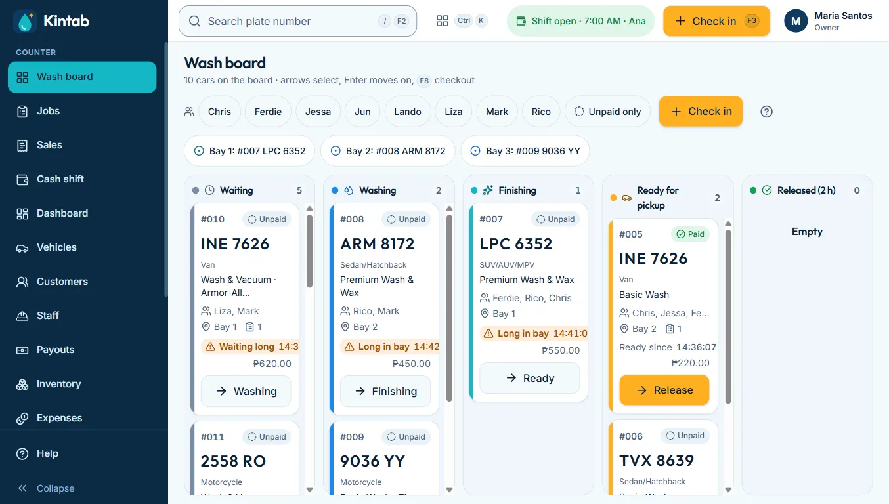
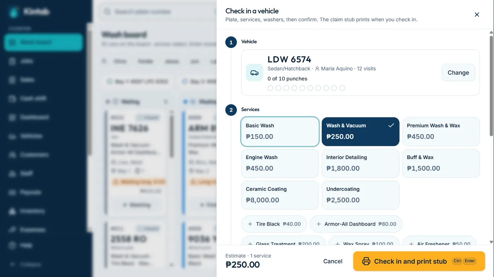
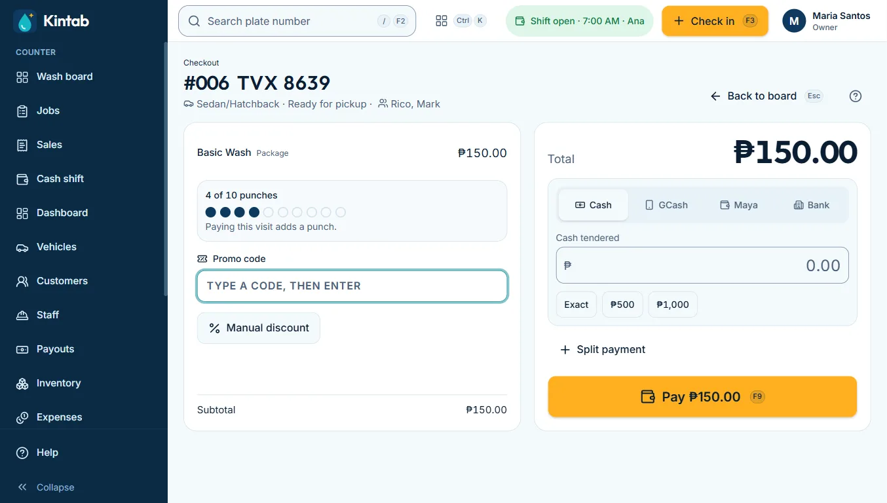
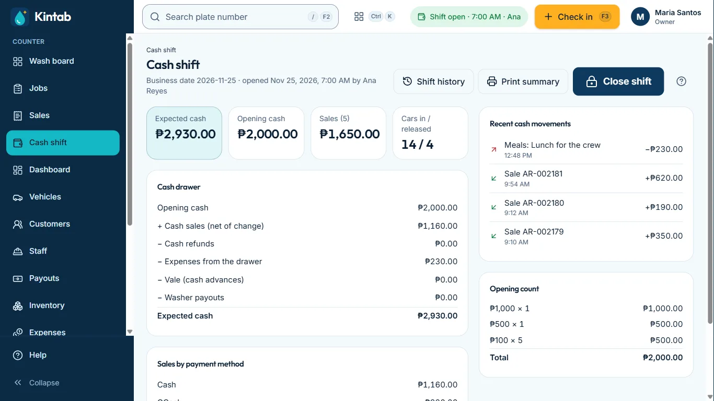
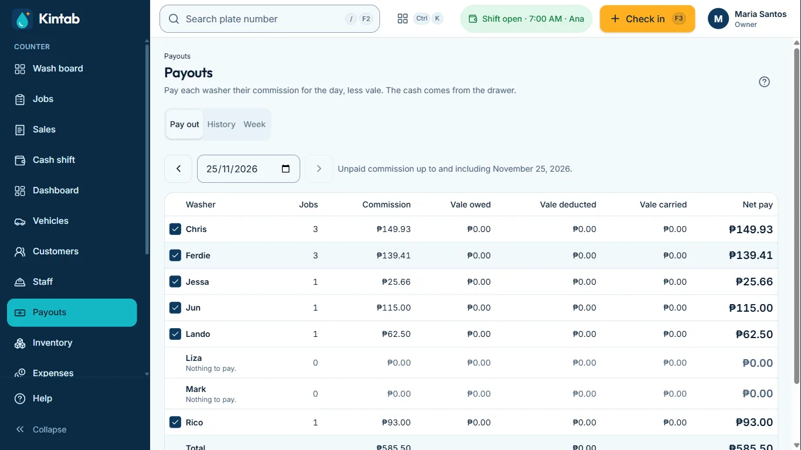
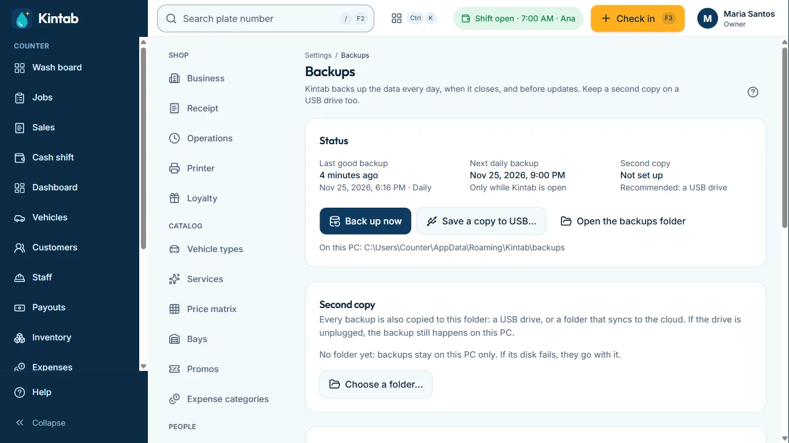

# Kintab releases

**Kintab** is a Windows desktop app for running a carwash counter: the wash board and job queue, checkout and
receipts, cash shifts, washer commissions and payouts, loyalty punch cards, inventory, expenses and reports. It runs
on one PC, fully offline, and keeps its data on that PC.

This repository holds **only the installers** and the update files that installed copies download. There is no
source code here.

> Kintab is not a BIR cash register. Everything it prints says **NOT AN OFFICIAL RECEIPT**. It never sends SMS or
> email.

## Screenshots

*From the built-in demo data.*

**The wash board:** every car from check-in to pickup, with bays, washers and timers.

**Checking in a car:** plate, services, washers and the condition check, then the claim stub prints.

**Checkout:** promo codes, discounts, the loyalty free wash, cash, GCash, Maya and split payments.

**The cash shift:** what the drawer should hold, live, and a blind count at closing.

**Daily payouts:** each washer's commission, less vale, paid from the drawer with a slip to sign.

**Backups:** daily and on close, checked, with a second copy on a USB drive.

## Requirements

- Windows 10 or 11, 64-bit
- 4 GB RAM or more, an SSD recommended
- Optional: a 58 mm thermal receipt printer (USB), a touchscreen, and a USB drive for backups

## Installing

1. Open the [latest release](../../releases/latest) and download **Kintab-Setup-x.y.z.exe** under *Assets*.
2. Run it. If Windows says **"Windows protected your PC"**, choose **More info**, then **Run anyway** (the installer
   isn't code-signed yet).
3. No administrator password is needed: Kintab installs for the current Windows user, in
   `%LOCALAPPDATA%\Programs\Kintab`, with a desktop shortcut.
4. Open Kintab. **Setup** asks for the business name, the owner's account and manager PIN, then shows a **recovery
   key** once. Write it down and keep it away from the counter.

**Moving from another PC?** On the first Setup screen choose **Restore from a backup** and pick a Kintab backup file
(`kintab-….db`). Everything comes back: data, accounts and settings.

## Updates

- Kintab checks this page for a new version shortly after it opens and every 6 hours, and downloads it in the
  background. Offline is fine: it simply tries again later.
- When an update is ready, the top bar shows **Update ready**. The owner reads what's new and chooses
  **Restart & update**.
- Updates **never install while a cash shift is open**. Close the shift first.
- Kintab backs up the data before every update.

## Your data

- The data and its backups live in `%APPDATA%\Kintab`, separate from the program.
- Kintab backs up every day at 9:00 PM and every time it closes. Set a second copy on a USB drive in
  **Settings → Backups**.
- **Uninstalling keeps the data.** Installing again opens it as it was. To remove everything, uninstall and then
  delete the `%APPDATA%\Kintab` folder.

## Help

Press **F1** on any screen in Kintab, or open **Help** at the bottom of the menu, for the built-in user guide. Every
chapter can be printed.

## Versions

Each release lists what changed, in plain words. Versions follow *major.minor.patch*: patches are fixes, minor
versions add features.
